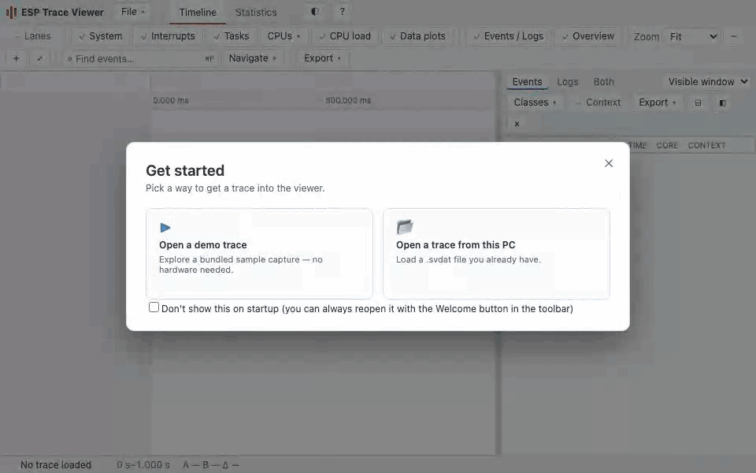

# esp-trace-viewer

Esp-trace-viewer is a browser-based viewer for embedded trace recordings. It does all processing locally in the browser window, without sending any files to external servers or installing any other software. It currently reads `.svdat` files produced by [ESP-IDF esp_sysview component](https://components.espressif.com/components/espressif/esp_sysview) and the [Zephyr tracing subsystem](https://docs.zephyrproject.org/latest/services/tracing/index.html#segger-systemview-support). Support for other trace formats will be added in the future.

[Open the viewer →](https://espressif.github.io/esp-trace-viewer/)

The viewer reads `.svdat` trace files produced by the ESP-IDF application-trace backend (captured with OpenOCD or `idf.py`) and by the Zephyr tracing subsystem. Supported inputs include single-core files, per-core file pairs, and combined multi-core files, which the parser splits automatically. Loading an application `.elf` file alongside a trace resolves heap-allocation call stacks and function traces to symbol names, and names of the kernel objects (threads, semaphores, mutexes, timers) events refer to. The viewer verifies the ELF file against the SHA-256 hash embedded in the capture and warns on any mismatch.

## Usage

### Recording trace files

- ESP-IDF: follow the instructions in [examples/system/tracing/sysview_tracing](https://github.com/espressif/esp-idf/tree/master/examples/system/tracing/sysview_tracing) to record a trace.
- Zephyr: build the application with `CONFIG_TRACING=y` and `CONFIG_SEGGER_SYSTEMVIEW=y` (see the [tracing guide](https://docs.zephyrproject.org/latest/services/tracing/index.html#segger-systemview-support)).

### Opening and saving files

- Use the **File** menu (**Open Trace**, **Load ELF**, **Save Trace**, **Clear Trace**) or drag and drop `.svdat` and `.elf` files directly onto the browser window.
- Three built-in demo captures are available from the welcome screen (click **?** in the top bar or open it from the **File** menu).
- Loading an application `.elf` file alongside a trace resolves symbols and kernel object names.
- **Save Trace** embeds the current lane layout into the `.svdat` header and downloads the file, preserving your customized layout when reopened.

### Workspaces

Switch between analysis workspaces using the tabs in the top bar:

- Timeline: The primary trace visualization workspace featuring activity, CPU load, function trace and data plot lanes, the lane configuration panel, and the Events/Logs dock.
- Statistics: Tabular breakdown of runtime statistics aggregated per context (tasks, interrupts, scheduler, and idle). Displays run counts, frequencies, min/max/average/total run times, and CPU core utilization with visual percentage bars.
  - Choose a calculation scope (**Visible window**, **Selection**, or **Full range**) and filter by context type.
  - Click any duration in the **Max run** column to switch to the Timeline and zoom directly into that execution run.

### Navigation and zooming

- Zoom using the toolbar presets dropdown (**Fit**, **1 s**, **100 ms**, etc.), zoom buttons (`+`, `−`, `⤢`), keyboard shortcuts (`+`, `-`, `0`), arrow keys, or the mouse wheel over the timeline.
- Toggle the **Overview** button to display or hide the whole-capture minimap strip above the timeline ruler.
- The **Navigate** menu provides quick actions to jump to the start or end of the trace, step through events (`]`, `[`), step within the current context (`}`, `{`), and zoom to selection.

### Lane configuration

Click the **Lanes** toggle button in the Timeline toolbar to open the docked lane configuration panel:

- Reorder lanes via drag-and-drop handles (`⋮⋮`) or up/down buttons (`↑`, `↓`).
- Show or hide individual lanes and groups with checkboxes.
- Organize lanes into groups, rename groups (double-click a group label), and ungroup as needed.
- Add new lanes for detected tasks, interrupts, or data plot series with **＋ New lane**, or create groups with **＋ New group**.
- Adjust lane row density.
- For contexts with instrumented function call tracing, toggle the flame-graph disclosure button (`ƒ`) in the lane row to view call stacks inline.

### Events and Logs panel

Click **Events / Logs** in the Timeline toolbar to show or hide the docked list panel:

- Dock placement: Dock to the right (`◧`) or bottom (`⊟`) of the timeline, or drag the splitter to resize.
- Tabs: Switch between **Events**, **Logs** (formatted printf and system log messages), or view **Both** side by side.
- Selection: Clicking an event or log row synchronizes selection across all panes and centers the cursor time. Shift-click or Shift-arrow keys selects a range; press `Ctrl-C` or `⌘-C` to copy selected rows as a Markdown table.
- Filtering & Scope:
  - Scope dropdown: Limit rows to the **Visible window**, current **Selection**, or **Full range**.
  - Context: Toggle to restrict rows to the currently selected context.
  - Classes: Filter by event classes (Tasks, System, ISR, Traces, Heap, etc.).

### Search and filtering

- Quick filters: Toggle lane groups on and off directly from the toolbar (**System**, **Interrupts**, **Tasks**, **CPU load**, **Data plots**).
- CPU cores: Use the **CPUs** dropdown to toggle visibility of individual CPU cores in multi-core traces.
- Find box: Type in the search input in the toolbar to instantly filter the Events and Logs lists by text.
- Find bar: Press `Ctrl-F` or `⌘-F` (or choose **Navigate** → **Find…**) to open the find bar. Step through query matches with `Enter` and `Shift-Enter`, or jump directly to a timestamp (e.g. `1.5 ms`) or event number (`#`).

### Reference markers

- Hover the cursor over the timeline and press `R` (or choose **Navigate** → **Toggle Reference**) to drop a reference marker.
- Place multiple markers to measure the elapsed time (Δ) between them, displayed in the status bar.
- Press `Shift-R` (or **Navigate** → **Clear All References**) to clear all markers.

### Exporting data

Export menus are available across the interface:

- Timeline: Export the visible timeline as a high-resolution PNG image, or export visible runs as CSV, JSON, or Markdown tables.
- Events & Logs: Export the displayed event list or log lines from the dock header as CSV, JSON, or Markdown (respecting active filters and scope).
- Statistics: Export the context statistics table as CSV, JSON, or Markdown.

## Licence

This project is licensed under Apache-2.0. See [LICENSE](LICENSE) and [NOTICE](NOTICE).
